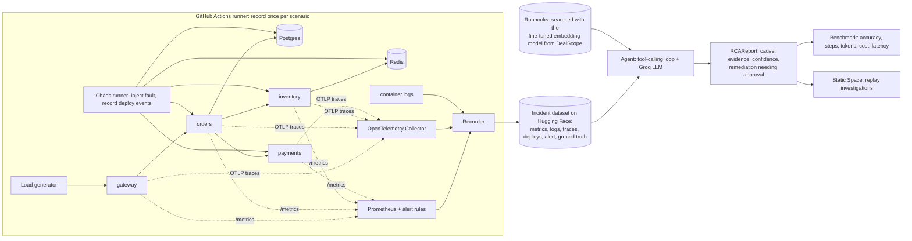

# Incident Copilot: design

## Goal

Show how an LLM agent fits into a real on-call workflow: an alert fires on a running system, the agent
investigates the same telemetry an engineer would use (metrics, logs, traces, deploy history, runbooks),
and posts an evidence-linked root-cause report with a suggested fix that a human must approve.
Measure it honestly against simple baselines on incidents whose true cause is known.

## Constraints

- **No paid infrastructure.** The system under test runs on free GitHub Actions runners (Docker included);
  the LLM is a free tier (Groq); the demo is a static Hugging Face Space.
- **Free LLM quotas are small** (about 200K tokens per model per day on Groq). Tool outputs must be compact
  summaries, not raw dumps; benchmark runs are spread across models and days.
- **Reproducible.** Telemetry is recorded once per scenario and replayed for every agent run, so results do
  not depend on timing luck and anyone can re-run the benchmark offline.

## Architecture

## System under test

Four FastAPI services (gateway, orders, inventory, payments), Postgres, Redis. Each service:
OpenTelemetry tracing (OTLP to the collector, file exporter), Prometheus metrics (request rate, latency
histogram, errors, DB pool usage, cache hits, memory), structured JSON logs. A load generator sends steady
traffic. Prometheus alert rules fire on error rate, p95 latency and saturation, like a real on-call setup.

"Deploys" are real: the chaos runner restarts a service with a new version tag and changed configuration,
and records the deploy event (service, version, time, change summary), exactly what a CD system would log.

## Scenarios (target 15+)

Each scenario = baseline traffic, then a fault, then recording. Ground truth = cause category + component.

| Category | Example injection |
|---|---|
| bad_deploy_code | payments v2.4 throws on a new currency field |
| bad_deploy_config | orders DB pool size set to 1; wrong timeout |
| db_missing_index | migration drops the index on orders.user_id |
| db_lock_contention | long transaction holds row locks |
| dependency_down | Redis stopped |
| slow_dependency | payments provider latency +2 s |
| resource_exhaustion | inventory memory leak; CPU hog |
| retry_storm | gateway retries x5 on a partial payments failure |
| credentials_error | rotated DB password not deployed |

Hard cases on purpose: a **red-herring deploy** (a harmless deploy just before an unrelated failure),
**noisy warnings** that are always present, and **cascades** where the alerting service is not the cause.

## Agent

Plain Python tool-calling loop (no framework, bounded steps, schema-validated output, re-ask on failure).
Tools return compact, citeable summaries:

| Tool | Returns |
|---|---|
| `get_alert()` | alert name, service, start time, threshold |
| `query_metric(name, service, window)` | baseline vs incident stats + a coarse series |
| `search_logs(service, level, contains, window)` | counts + top distinct messages with ids |
| `get_slow_traces(service, window)` | slowest traces with the span that dominates the time |
| `list_deploys(window)` | deploys with version and change summary |
| `search_runbooks(query)` | best-matching runbook sections (semantic search) |

Output: `RCAReport` with `cause_category` (fixed enum) and `component` (service or dependency), so scoring is
deterministic, plus evidence that must reference ids actually returned by tools (checked automatically).

## Evaluation

- **Baselines:** (1) "blame the last deploy" rule; (2) single LLM prompt with a pre-built summary of all
  telemetry; (3) the tool-using agent, with two or three free models.
- **Metrics:** root-cause accuracy (category and component), evidence validity, steps, tokens, cost per
  investigation, wall-clock time; bootstrap confidence intervals; error analysis per scenario type.

## Demo

Static Hugging Face Space that replays recorded investigations: pick an incident, see the alert and metric
charts, watch each agent step (tool call, what it found), then the report next to the ground truth, with an
"approve remediation" step. A benchmark tab shows the results table.

## Milestones

1. System under test + telemetry + alert rules running in Docker Compose on GitHub Actions.
2. Chaos runner + recorder; 15+ scenarios recorded; dataset published.
3. Agent + tools + runbooks; validated reports.
4. Baselines + benchmark + error analysis.
5. Demo Space, README, CV.
