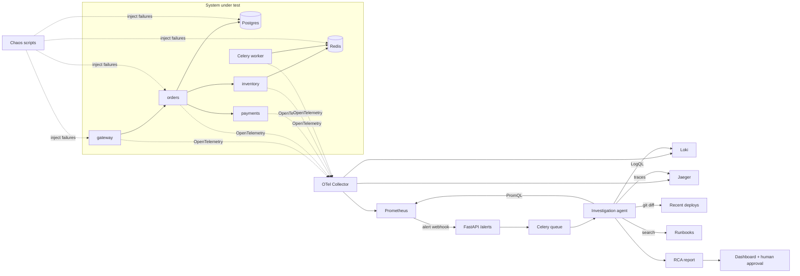

# Incident Copilot

**An AI on-call agent that investigates production alerts across metrics, logs, traces and deploys,
then reports an evidence-linked root cause, scored against a chaos-engineering benchmark.**


## The problem

When an alert fires at 2 a.m., the on-call engineer spends the first 30 to 60 minutes jumping between dashboards,
log searches, traces and recent deploys to work out what actually broke. Most of that is a repeatable
investigation that follows the same playbook every time.

Incident Copilot runs that investigation automatically. It receives the alert, gathers evidence through tools,
and produces a root-cause report with links to the exact evidence, a confidence score and a suggested fix.
Any remediation is limited to an allowlist and waits for human approval.

The important part is measurement: a chaos benchmark injects known failures into a real multi-service system
and scores whether the agent finds the right cause, how fast, and at what cost.

## Architecture



## Roadmap

| Milestone | Scope | Status |
|---|---|---|
| v0.1 | `RCAReport` schema; 4-service system in Docker Compose with OpenTelemetry, Prometheus, Loki, Jaeger, Grafana | in progress |
| v0.2 | First 5 chaos scenarios and matching Prometheus alert rules; runbooks | planned |
| v0.3 | Alert webhook to Celery; investigation agent with metrics, logs, traces, deploy and runbook tools | planned |
| v0.4 | Benchmark runner: root-cause accuracy, time to diagnosis, cost per investigation, run in CI | planned |
| v1.0 | 15 scenarios, dashboard, allowlisted remediation with human approval, Terraform for AWS | planned |

## Planned chaos scenarios

Connection-pool exhaustion, dropped index causing slow queries, Redis outage, retry storm, bad deploy,
memory leak, queue backlog, slow downstream dependency, misconfigured environment variable, and more.

## Tech stack

Python 3.11, FastAPI, Celery, Redis, PostgreSQL, OpenTelemetry, Prometheus, Loki, Jaeger, Grafana,
Docker Compose, GitHub Actions, Terraform. LLM-agnostic: runs on Gemini or Groq free tiers, or locally with Ollama.

## Project layout

```
agent/        investigation agent, tools and report schema
services/     the 4-service system under test
chaos/        failure-injection scripts
benchmark/    scenario runner and scoring
runbooks/     markdown runbooks the agent can search
infra/        Prometheus rules, collector config, Terraform
tests/        unit tests
```

## Getting started

```bash
uv sync --extra dev
uv run pytest
```

## Benchmark results

Published here once the benchmark runs.

## License

MIT
